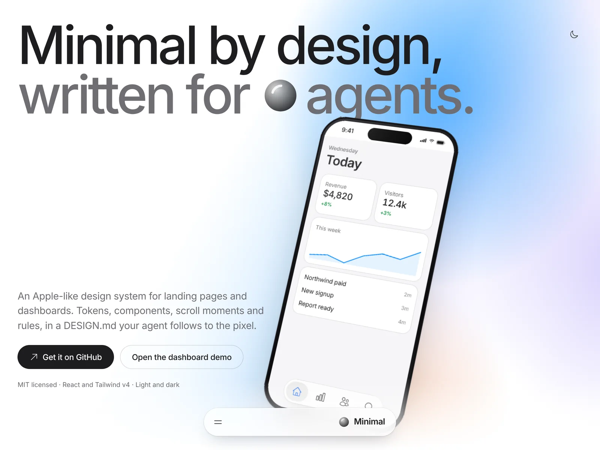
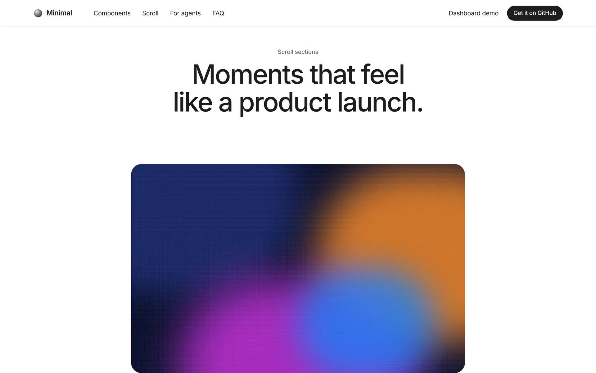
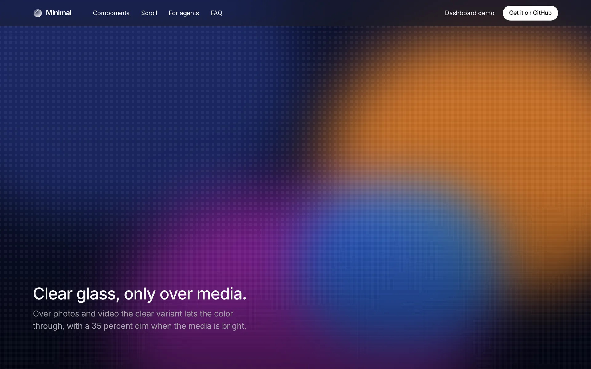
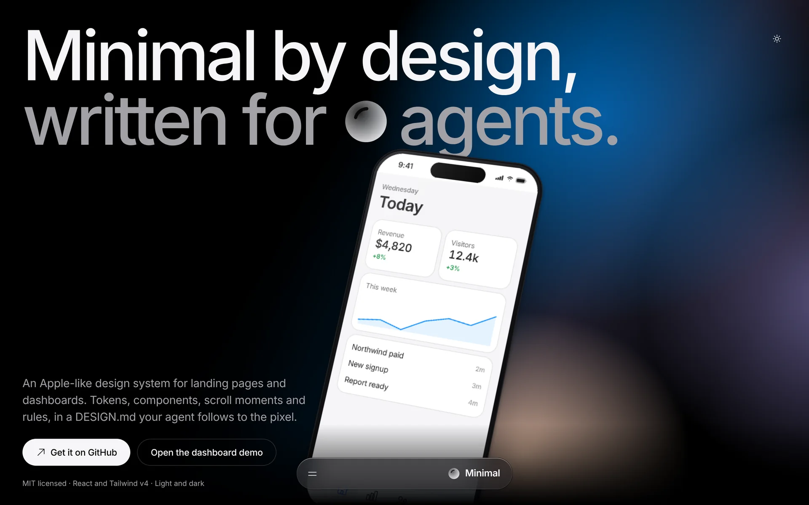

# UI Design Minimal

An Apple-like, super clean minimal design system with Liquid Glass controls for **landing pages and product UI**. Tokens, components, scroll showpieces and rules, written so AI coding agents (Claude Code, Cursor, Lovable, v0, Codex …) follow them to the pixel.

Made by **[Tammo Elsner](https://www.linkedin.com/in/tammo-elsner-682998186/)** · MIT



**[Download ZIP](https://github.com/tammo1007/ui-design-minimal/archive/refs/heads/main.zip)** · [Skill on alyn.dev](https://alyn.dev/skills/ui-design-minimal) · [DESIGN.md on freedesignmd](https://freedesignmd.com/system/minimalistic)

## What you need (all of it)

The system only looks right when every part is in the project. A DESIGN.md alone gives an agent the rules, but not the CSS and components the rules point to.

| Folder or file | Why it is needed |
|---|---|
| `src/styles/` (4 CSS files) | Every token, the glass material, the product layer and the scroll stages. Without them nothing renders correctly. |
| `src/components/lg/` | The 48 components the rules refer to (`DockNav`, `CardRail`, `AppShell`, `MediaExpand` …). |
| `src/lib/cn.ts` | Class merging that knows the token classes; components import it. |
| `DESIGN.md`, `AGENTS.md`, `docs/COMPONENTS.md` | The rules, the build steps and the exact specs your agent follows. |
| `scripts/lg-audit.mjs` | Fails the build when something drifts from the system. |
| `tokens/tokens.json` | The same tokens for Figma and other design tools (optional). |

Get everything at once with the ZIP above, `git clone`, or the installer below.

## What is inside

- **DESIGN.md**: every token in the front matter (DESIGN.md format) and every rule in plain sentences: colors, two type scales, layout, elevation, Liquid Glass, shapes, components, motion, page recipes, accessibility, do's and don'ts.
- **Two densities from one token set.** Marketing scale for websites (17 px body, 123 px hero) and a product scale for dashboards and apps (14 px body, 32 px controls, 44 px rows), derived from Apple's iOS and macOS text styles.
- **Real Liquid Glass rules** from Apple's Human Interface Guidelines: regular, thick and clear glass, only on navigation and controls, with fallbacks for reduced transparency and increased contrast.
- **Light, dark and increased contrast** for every color, using Apple's system palette.
- **48 React components**: page structure, marketing sections, the horizontal **CardRail**, devices, an **AppShell** with a floating glass sidebar, toolbar, tab bar, data tables, charts, metrics, controls, menus, dialogs, sheets and toasts.
- **Scroll showpieces**: `MediaExpand`, `ZoomThrough`, `StackCards`, `PinnedGallery`, `ScrollStory`, `TextReveal`, `ParallaxColumns`, all reduced-motion safe.
- **An audit** (`npm run audit`) that fails on raw colors, default font sizes, the wrong type scale, glass on cards, missing CardRails and too many pinned sections.
- **W3C tokens** (`tokens/tokens.json`, DTCG 2025.10) generated from the CSS.
- **A skill** (`skill/ui-design-minimal`) for Claude and other agents.
- **Heroicons** outline at stroke 1.35, nothing else.

| CardRail (on every landing page) | StackCards |
|---|---|
|  |  |
|  |  |
|  |  |

## Quick start

```bash
git clone https://github.com/tammo1007/ui-design-minimal
cd ui-design-minimal
npm install
npm run dev        # / landing · /dashboard/ · /styleguide/
npm run check      # tokens + skill sync + audit + typecheck + build
```

### Use it in your project (one command)

```bash
npx skills add tammo1007/ui-design-minimal      # the agent skill, with DESIGN.md, AGENTS.md and specs as references
node .claude/skills/ui-design-minimal/scripts/install.mjs   # copies all 49 system files into your project
```

The installer writes `src/styles/*`, `src/components/lg/*`, `src/lib/cn.ts`, `DESIGN.md`, `AGENTS.md`, `docs/COMPONENTS.md`, `tokens/tokens.json`, `scripts/lg-audit.mjs`, a `src/styles/liquid-glass.css` entry and an `audit` npm script. It never overwrites existing files unless you pass `--force`, and prints the three remaining steps (npm install, one CSS import, the `@/` alias).

### Or by hand

1. Copy `src/styles/`, `src/components/lg/` and `src/lib/cn.ts` into your React + Tailwind v4 project.
2. `npm i motion lenis clsx tailwind-merge class-variance-authority @radix-ui/react-slot @heroicons/react @fontsource-variable/inter`
3. Import the styles in this order:
   ```css
   @import "tailwindcss";
   @import "@fontsource-variable/inter";
   @import "./styles/lg-tokens.css";
   @import "./styles/lg-tailwind.css";
   @import "./styles/lg-product.css";
   @import "./styles/lg-scroll.css";
   ```
4. Put `DESIGN.md`, `AGENTS.md` and `docs/COMPONENTS.md` in your project root and tell your agent to follow them. Add `scripts/lg-audit.mjs` and run it before you ship.

### With an AI agent

> Build my landing page with UI Design Minimal. Follow DESIGN.md and AGENTS.md exactly and run the audit at the end.

Or install the skill from `skill/ui-design-minimal` (also listed on [alyn.dev](https://alyn.dev)) and the design system on [freedesignmd.com](https://freedesignmd.com/system/minimalistic).

## Repository map

| Path | Purpose |
|---|---|
| `DESIGN.md` | Tokens and rules, the file agents read first |
| `AGENTS.md` | Install, how to build marketing and product pages, Definition of Done |
| `docs/COMPONENTS.md` | Exact specs of every component |
| `src/styles/` | `lg-tokens.css` (all values), `lg-tailwind.css`, `lg-product.css`, `lg-scroll.css` |
| `src/components/lg/` | All primitives, barrel `@/components/lg` |
| `src/demo/` | Landing, dashboard and styleguide demos |
| `tokens/tokens.json` | W3C design tokens |
| `skill/` | Agent skill with references |
| `scripts/` | `lg-audit.mjs`, `build-tokens.mjs`, `sync-skill.mjs` |
| `CLAUDE.md`, `.cursor/rules/`, `llms.txt` | Agent entry points |

## Principles in one breath

Content first, glass on top. Monochrome chrome, one accent, one prominent action per view. Two-tone, left-aligned headers. Marketing scale on websites, product scale in apps, never mixed. Concentric radii, capsule controls. Solid content, glass controls, never glass on glass. Motion that explains, with transform and opacity only.

## Credits and license

Designed and built by [Tammo Elsner](https://www.linkedin.com/in/tammo-elsner-682998186/). MIT license.

Based on the public [Apple Human Interface Guidelines](https://developer.apple.com/design/human-interface-guidelines) and the [Liquid Glass overview](https://developer.apple.com/documentation/technologyoverviews/liquid-glass). Not affiliated with or endorsed by Apple Inc. No Apple fonts, icons or assets are included: Apple devices render SF Pro as their system font, everyone else gets Inter.
